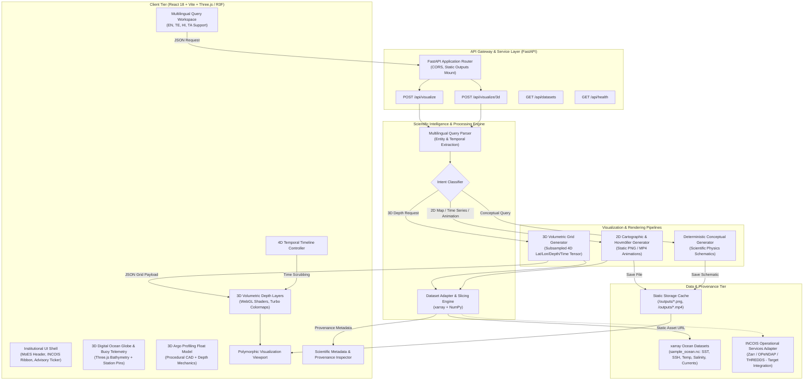

# GYANI Intelligent Scientific Visualization Prototype

A runnable prototype of the visualization module described in the GYANI project specification.

## What this prototype does

1. Accepts a natural-language ocean-science query.
2. Detects whether it is a data-driven visualization or conceptual visualization.
3. Extracts:
   - variable
   - region/location
   - date range
   - visualization type
4. Loads a sample NetCDF ocean dataset with `xarray`.
5. Generates:
   - SST animated maps
   - SSH animated maps
   - temperature time/depth plots
   - salinity time/depth plots
   - current/vector visualizations
   - time-series plots
   - conceptual ocean-science diagrams
6. Returns the generated visualization and metadata through FastAPI.
8. Renders interactive 3D underwater depth layers (Three.js & React Three Fiber) with real-time temporal playback animations.
9. Displays revolving 3D oceanographic models: Digital Ocean Globe with INCOIS buoys, Argo Profiling Float, and Marine Compass Gyroscope.
10. Provides an institutional layout aligned with the official INCOIS portal (MoES topbar, navigation ribbon, live bulletin ticker, and service cards).
11. Includes multilingual UI and query support for English, Telugu, Hindi, and Tamil.

The sample data is synthetic and clearly marked as demo data. Replace the dataset adapter later with verified INCOIS NetCDF/Zarr/model/observation data.

## System Architecture

GYANI is architected as an intelligent, decoupled ocean-science exploration platform designed to bridge natural-language user inquiries with scientific dataset manipulation and high-fidelity 3D/2D visual rendering.

### Architecture Overview



### Core Architecture Components

#### 1. Client Presentation Tier (`frontend/`)
- **Institutional INCOIS Portal Shell**:
  - Aligned with the design language of the Ministry of Earth Sciences (MoES) and INCOIS.
  - Implements `InstitutionalHeader` with language toggling (`en`, `te`, `hi`, `ta`), accessibility font controls, and institutional links.
  - Features `INCOISNavRibbon` for operational navigation across ocean data products.
  - Displays a live `AdvisoryTicker` highlighting Indian Ocean sea-state alerts, swell surges, and tsunami readiness status.
  - Interactive `INCOISServiceCards` offering quick-action entry points for operational services (PFZ, OSF, CBAS, Tsunami Warnings).
- **Interactive 3D Geospatial & Oceanographic Engine**:
  - `OceanGlobe3D`: A Three.js/React Three Fiber 3D globe with high-resolution Blue Marble bathymetry, specular water highlights, and interactive INCOIS moored buoy stations (AD01, BD08, CB02, DS04) that can be inspected and queried.
  - `ArgoFloat3D`: An interactive 3D mechanical model of an Argo profiling float showcasing CTD conductivity-temperature-depth sensors, antenna, and internal buoyancy cycle physics.
  - `UnderwaterScene` & `DepthLayerMesh`: Multi-layered volumetric ocean rendering (0m to 200m depth planes) with dynamic WebGL vertex displacements and scientific thermal color gradients (Turbo/Viridis).
  - `TimelineControls`: 4D temporal animation engine providing play/pause, time-step scrubbing, and variable playback speeds (0.5x–2.0x).
- **Multilingual Query Workspace & Viewport**:
  - `QueryWorkspace`: Natural-language search interface with speech input integration and localized sample prompt suggestions.
  - `VisualizationViewport`: Polymorphic container dynamically switching between interactive 3D WebGL scenes, Matplotlib rasters (SST/SSH heatmaps, vector quiver current maps), Hovmöller time-depth diagrams, and MP4 animations.
  - `ScientificMetadataPanel`: Displays provenance, grid bounds, depth resolutions, and data classification tags.

#### 2. Backend Application & Processing Tier (`backend/`)
- **FastAPI Service Core (`app/main.py`)**:
  - Exposes RESTful endpoints (`/api/visualize`, `/api/visualize/3d`, `/api/datasets`, `/api/health`).
  - Implements CORS middleware and mounts `/outputs` for cached media delivery.
  - Enforces strict response models and robust error handling.
- **Multilingual Query Intelligence (`services/query_parser.py`)**:
  - Deterministic normalizer mapping scientific queries across English, Telugu (తెలుగు), Hindi (हिन्दी), and Tamil (தமிழ்).
  - Extracts oceanographic variables (`sst`, `ssh`, `temperature`, `salinity`, `current`, `mixed_layer_depth`), spatial regions (Arabian Sea, Bay of Bengal, Indian Ocean), coordinate pairs (`lat/lon`), and time windows (`June 2025`, ISO date ranges).
  - Categorizes queries into 3D Volumetric Layer requests, 2D Data Visualizations, or Conceptual Ocean Physics Schematics.
- **Dataset Slicing & Tensor Streamer (`services/dataset_service.py`)**:
  - High-performance multi-dimensional data slicing powered by `xarray` and `NumPy`.
  - Spatiotemporal nearest-neighbor and bounding box sub-selection.
  - `extract_3d_grid`: Spatial subsampling and multi-depth 4D tensor formatting (`[depth][time][lat][lon]`) optimized for low-latency JSON delivery to WebGL.
  - Abstracted dataset adapter ready to plug into operational INCOIS OpenDAP / TDS (THREDDS) / Zarr / NetCDF data feeds.
- **Scientific Visualization Engine (`services/visualization_service.py`)**:
  - Generates publication-ready 2D graphics and temporal animations via `matplotlib` (using headless `Agg` backend).
  - Supports 2D cartographic scalar maps, vector quiver current fields, Hovmöller depth-time cross sections, and time-series plots with error bands.
- **Conceptual Schematic Engine (`services/conceptual_service.py`)**:
  - Deterministic vector-graphic schematic generation for educational oceanographic phenomena (Coastal Upwelling, Thermocline stratification, Ocean Eddies, Salt Fingers, ENSO / IOD).
  - Strictly isolated from data-driven pipelines to guarantee scientific integrity.

### Data Flow Lifecycle

1. **User Inquiry**: User enters a natural-language query in English, Telugu, Hindi, or Tamil via the UI or clicks a buoy on the 3D globe / service card.
2. **Normalization & Entity Extraction**: Backend normalizes localized terminology and extracts spatial, temporal, and variable entities.
3. **Intent Routing**: Query is classified into **Data-driven 3D**, **Data-driven 2D/Animation**, or **Conceptual Diagram**.
4. **Dataset Slicing**: `xarray` subsets the target NetCDF/Zarr dataset across coordinates, depth levels, and temporal slices.
5. **Rendering & Payload Delivery**:
   - For 3D queries: Formats a compact 4D coordinate-grid JSON tensor and streams to the client for WebGL GPU rendering.
   - For 2D/Animation queries: Generates PNG or MP4 artifacts in `/outputs` and returns the asset URI with metadata.
   - For Conceptual queries: Produces an annotated scientific schematic diagram explaining the ocean phenomenon.
6. **Client Visualization & Inspection**: React renders the polymorphic output, updates the interactive timeline controls, and populates the metadata/provenance panel.

## Requirements

- Python 3.10+
- Node.js 18+

## 1. Start backend

```bash
cd backend
python -m venv .venv
```

Windows:

```bash
.venv\Scripts\activate
```

Linux/macOS:

```bash
source .venv/bin/activate
```

Install:

```bash
pip install -r requirements.txt
```

Generate demo NetCDF:

```bash
python data/generate_sample_data.py
```

Start API:

```bash
uvicorn app.main:app --reload --port 8000
```

Open:

```text
http://localhost:8000/docs
```

## 2. Start frontend

In another terminal:

```bash
cd frontend
npm install
npm run dev
```

Open the URL shown by Vite, normally:

```text
http://localhost:5173
```

## Example queries

```text
Show SST evolution in the Arabian Sea during June 2025
```

```text
Show SSH evolution in the Bay of Bengal
```

```text
How did temperature change with depth at 10 N 75 E during June 2025?
```

```text
Show the current pattern during June 2025
```

```text
What is coastal upwelling?
```

## API

### POST `/api/visualize`

Example:

```json
{
  "query": "Show SST evolution in the Arabian Sea during June 2025"
}
```

The API returns a visualization URL, metadata, parsed intent and explanation.

### GET `/api/datasets`

Returns the currently configured datasets.

### GET `/api/health`

Health check.

## Replacing the sample dataset with INCOIS data

The important integration point is:

```text
backend/app/services/dataset_service.py
```

Replace the demo dataset path/adapter with the INCOIS NetCDF/Zarr source.

The visualization functions already consume an xarray Dataset, so the visualization layer can remain largely unchanged.

## Scientific integrity

The prototype does NOT use generative AI to invent scientific data.

For data-driven requests:

```text
Dataset -> subset -> visualization
```

For conceptual requests, the prototype uses deterministic schematic diagrams. A generative-AI conceptual illustration service can be added later as a separate module.

This separation is intentional and follows the project requirement that data-derived visualizations preserve the underlying dataset.

## Project structure

```text
GYANI/
├── backend/
│   ├── app/
│   │   ├── main.py                    # FastAPI application & REST route definitions
│   │   ├── models.py                  # Pydantic schemas (VisualizationRequest, Intent)
│   │   └── services/
│   │       ├── query_parser.py        # Multilingual normalizer & intent classifier
│   │       ├── dataset_service.py     # xarray NetCDF loader & 4D 3D-grid extraction
│   │       ├── visualization_service.py # Matplotlib 2D rasters, quivers & MP4 animations
│   │       └── conceptual_service.py  # Deterministic oceanographic physics diagrams
│   ├── data/
│   │   ├── generate_sample_data.py    # Synthetic Indian Ocean NetCDF dataset generator
│   │   └── sample_ocean.nc            # 4D NetCDF ocean dataset (0m - 200m depth)
│   ├── outputs/                       # Ephemeral cached visualizations (*.png, *.mp4)
│   ├── tests/                         # Backend test suite (pytest)
│   │   ├── test_baseline.py
│   │   └── test_3d_grid.py
│   ├── pytest.ini
│   └── requirements.txt
├── frontend/
│   ├── public/
│   │   └── textures/                  # Earth Blue Marble, bathymetry & specular textures
│   ├── src/
│   │   ├── components/
│   │   │   ├── Common/
│   │   │   │   ├── AdvisoryTicker.jsx       # Live ocean advisory & alert banner ticker
│   │   │   │   └── ScientificLegend.jsx     # Calibrated scientific colorbar legend
│   │   │   ├── Header/
│   │   │   │   ├── InstitutionalHeader.jsx  # MoES / INCOIS header & language switcher
│   │   │   │   └── INCOISNavRibbon.jsx      # Operational services navigation ribbon
│   │   │   ├── Home/
│   │   │   │   └── INCOISServiceCards.jsx   # Interactive service cards (PFZ, OSF, CBAS)
│   │   │   ├── Metadata/
│   │   │   │   └── ScientificMetadataPanel.jsx # Provenance, grid bounds & data inspector
│   │   │   ├── ThreeD/
│   │   │   │   ├── OceanGlobe3D.jsx         # 3D digital ocean globe with buoy stations
│   │   │   │   ├── ArgoFloat3D.jsx          # Interactive 3D Argo profiling float model
│   │   │   │   ├── UnderwaterScene.jsx      # Volumetric depth-layer scene with lighting
│   │   │   │   ├── DepthLayerMesh.jsx       # Dynamic WebGL mesh with Turbo colormaps
│   │   │   │   ├── TimelineControls.jsx     # 4D temporal animation scrubber & speed
│   │   │   │   └── CompassGyro3D.jsx        # Oceanographic orientation gyro widget
│   │   │   ├── Viewport/
│   │   │   │   └── VisualizationViewport.jsx # Polymorphic 3D/2D/animation viewport
│   │   │   └── Workspace/
│   │   │       └── QueryWorkspace.jsx       # Natural language & voice query interface
│   │   ├── App.jsx                    # Primary application layout & orchestration
│   │   ├── index.css                  # INCOIS institutional design tokens & styles
│   │   └── main.jsx                   # React 18 DOM mount point
│   ├── package.json
│   └── vite.config.js
└── README.md
```


## Multilingual support

Use the language selector in the top-right of the React interface to switch between **English, Telugu, Hindi, and Tamil**. Labels, help text, example prompts, and the prototype notice are localized. The backend also normalizes common ocean-science terms in these languages so users can submit supported scientific queries directly in their selected language.
